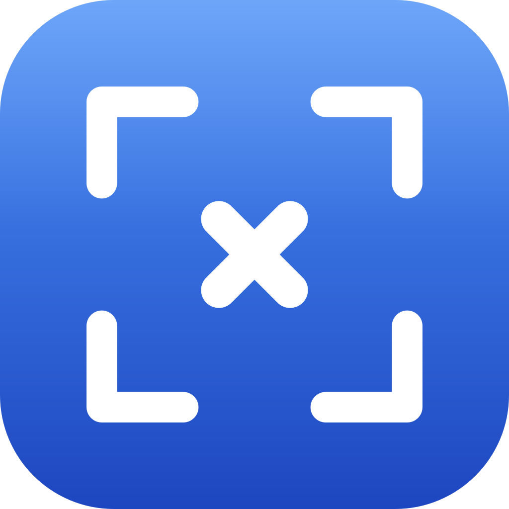

<div align="center">



# ShotX

**现代、轻量、高颜值的全能屏幕截图、标注、长截图与屏幕录制神器**  
*支持 macOS 与 Windows 双平台原生运行 · 键盘流操作 · 1:1 沉浸式体验*

[](https://github.com/muzi86754781/shotx/releases/latest)
[](https://github.com/muzi86754781/shotx/releases/latest)
[](https://swift.org)
[](https://dotnet.microsoft.com)
[](https://github.com/muzi86754781/shotx/releases/latest)
[](LICENSE)

[**📦 立即下载最新版本**](https://github.com/muzi86754781/shotx/releases/latest) · [✨ 功能全景](#-核心功能全景) · [⌨️ 快捷键](#️-默认快捷键对照表) · [📥 安装指南](#-安装指南) · [🛠️ 源码构建](#️-源码构建)

</div>

---

## 💡 为什么选择 ShotX？

ShotX 旨在融合极致的截图画质、轻盈丝滑的动画交互与全流程生产力工具链。无论是在 macOS 还是 Windows 上，ShotX 均采用纯原生架构构建，拒绝高内存占用的 Web 壳，启动极速、多屏高刷 Direct2D / Metal 硬件加速，让每一次截取与标注都如丝般顺滑。

---

## ✨ 核心功能全景

### 1. 🎯 多模态截屏系统
- **全能截图 / 区域截图**：十字放大镜取色准星、智能窗口边界探测与磁吸、8 向控制点（4角 + 4边）无级调整、按住 `Space` 随心平移选区。
- **上次区域截图**：自动记忆上一次框选位置与尺寸，无需重复拉框，一键直截。
- **全屏截图**：多显示器物理全景无损合成截取。
- **窗口截图**：悬停自动识别应用窗口层级，点击一键提取无杂质独立窗口画面。
- **定时截图**：支持 3 秒、5 秒、10 秒屏幕倒计时，方便截取展开菜单、悬浮提示与临时动态。
- **离线 OCR 识别**：原生搭载 Apple Vision (macOS) 与 WinRT OCR (Windows) 离线引擎，框选即可提取文字至剪贴板，隐私安全不上传云端。

### 2. 🎨 16 项高颜值胶囊工具栏与深度标注
- **基础图形**：
  - **矩形 / 椭圆**：支持「空心描边 / 实心填充」与「直角 / 圆角」自由组合；
  - **直线 / 箭头**：支持「平直」与「优雅双向贝塞尔曲线」模式；
  - **画笔工具**：普通笔触与荧光笔半透明高亮双模式；
  - **马赛克 / 高斯毛玻璃**：提供传统马赛克与现代高斯毛玻璃双模式，敏感隐私优雅遮挡；
  - **步骤序号标注**：①、②、③... 自动自增计数器，支持空心圆与实心圆样式；
  - **深度文字编辑**：支持**行内双击或单击已有文字再次进入编辑**；提供「无修饰」、「描边高对比」、「半透明胶囊背景」三级文字样式，支持前景色与背景色互换。
- **子工具栏与调色盘**：
  - 8 种系统级高对比度预设色盘（白、黑、红、橙、黄、绿、蓝、紫）；
  - 粗细调节滑块（2px ~ 32px）与不透明度无级调节（10% ~ 100%）。
- **顶部信息与微调条**：
  - 物理像素精确尺寸显示；
  - 平滑圆角滑块（0px ~ 48px），实时预览与裁剪透明通道；
  - 外发光弥散阴影开关，一键生成美化大片。

### 3. 📜 绝对底部水位线长截图 (Scroll Stitching)
- **底层算法**：采用绝对底部水位线扫描与 32 列方差梯度特征图像匹配算法；
- **智能防重复截取**：向下滑动页面自动无缝向下拼接，向上回滚滑动自动过滤重叠帧，绝不产生重复或错位错切；
- **超限保护**：支持高达 32,000 物理像素长图实时无损导出与剪贴板直传。

### 4. 📌 桌面贴图置顶系统 (Pin Window)
- 截图后按 `F3` 或点击钉子工具，将截图或剪贴板图片悬浮置顶在桌面最顶层；
- 鼠标滚轮平滑缩放、双击快速关闭；
- 右键快捷菜单支持「复制图片」、「另存为」、「阴影微调」与「重置原始尺寸」。

### 5. 🎥 屏幕与声音录制 (Screen & Audio Recording)
- 区域或全屏录制，支持高清 H.264 MP4 或 12fps 平滑 GIF 格式直接导出；
- **画中画摄像头 (Webcam Overlay)**：录屏中显示圆形摄像头画面，可实时拖拽移动和缩放；
- **鼠标点击特效**：高亮点击涟漪动画；
- **音频采集**：支持麦克风拾音与系统内录音频双通道录制。

### 6. 🌐 多语翻译与剪贴板历史
- **双语翻译中心**：支持「划词翻译」、「截图 OCR 翻译」与「独立双语输入翻译」，独立悬浮，失焦自动隐藏；
- **剪贴板历史管理器**：后台实时捕获剪贴板文本与图片，支持搜索过滤、快捷回填粘贴与历史管理；
- **桌面辅助**：独立拾色器模式（按 `C` 复制 HEX 颜色代码）、一键隐藏/恢复桌面图标（截图防干扰）。

---

## ⌨️ 默认快捷键对照表

| 功能操作 | macOS 快捷键 | Windows 快捷键 | 详细说明 |
|:---|:---|:---|:---|
| **区域截图** | `⌥ X` (Option+X) | `Alt + A` | 呼出全能截图覆盖层，支持框选与窗口吸附 |
| **上次区域截图** | `⌥ ⇧ X` | `Alt + R` | 按上一次相同位置尺寸自动截取 |
| **全屏截图** | `⌥ ⌘ X` | `Alt + Shift + A` | 截取全部显示器联合画面 |
| **窗口截图** | `⌥ W` | `Alt + W` | 鼠标悬停窗口自动吸附并截取 |
| **滚动长截图** | 胶囊栏「长」 | `Alt + S` | 选区后向下滚屏拼接长图 |
| **截图 OCR 识字** | `⌥ ⇧ T` | 胶囊栏「识」 | 框选后离线提取文字并复制进剪贴板 |
| **从剪贴板贴图** | `⌥ P` | `Alt + F3` | 将剪贴板中的图片悬浮置顶在桌面 |
| **改图 (剪贴板)** | `⇧ ⌘ V` | `Alt + P` | 从剪贴板打开图片直接进入标注画板 |
| **拾色器** | `⌥ ⇧ C` | 截图界面按 `C` | 放大镜取色，按 `C` 复制十六进制色值 |
| **屏幕录制** | `⌥ R` | 托盘菜单选择 | 支持录制 MP4 / GIF 与摄像头画中画 |
| **划词 / 输入翻译** | `⌥ T` | `Alt + V` | 呼出极简双语翻译浮动面板 |
| **剪贴板历史** | `⌥ C` | `Alt + C` | 呼出剪贴板历史记录窗进行搜索与复用 |
| **隐藏桌面图标** | `⌥ D` | 托盘菜单选择 | 一键隐藏/显示系统桌面图标，保持截屏整洁 |

---

## 📥 安装指南

### 方式一：官方 Releases 安装包下载（推荐）

前往 [GitHub Releases](https://github.com/muzi86754781/shotx/releases/latest) 下载对应系统的安装包：

- **macOS**：下载 `ShotX-x.y.z.dmg`，双击后将 `ShotX.app` 拖入 `Applications` 应用程序文件夹即可。
  > 第一次启动需在「系统设置 → 隐私与安全性 → 屏幕录制」中授予权限。
- **Windows**：
  - **安装版**：下载 `ShotX-Windows-Setup-x.y.z.exe`，向导式一键安装并自动创建桌面和开始菜单快捷方式；
  - **便携版**：下载 `ShotX-Windows-x.y.z-Portable.zip`，解压即用，无任何环境依赖。

### 方式二：macOS Homebrew 自动化安装

```bash
brew tap muzi86754781/shotx https://github.com/muzi86754781/homebrew-shotx
brew install --cask shotx
```

---

## 🛠️ 源码构建

### macOS 客户端构建
- **依赖环境**：macOS 13.0+，Xcode 15+（Swift 5.9+）
```bash
git clone https://github.com/muzi86754781/shotx.git
cd shotx

swift run                     # 开发调试模式运行
./Scripts/build-app.sh        # 打包生成 ShotX.app
./Scripts/make-dmg.sh         # 打包生成安装 DMG
```

### Windows 客户端构建
- **依赖环境**：Windows 10/11，.NET 8.0 SDK，Visual Studio 2022 或 VS Code
```bash
cd ShotX-Windows
dotnet build ShotX.Windows.sln -c Release

# 打包发布独立免安装 x64 程序
dotnet publish ShotX.Windows/ShotX.Windows.csproj -c Release -r win-x64 --self-contained true
```

---

## 🏗️ 架构与生态

ShotX 坚持采用平台第一方原生技术实现极致性能体验：
- **ShotX macOS**：基于 **Swift 5.9 + AppKit + SwiftUI + ScreenCaptureKit + Vision + AVFoundation** 构建，内存占用常驻仅 ~25MB；
- **ShotX Windows**：基于 **C# .NET 8 + WPF 硬件渲染引擎 + Win32/GDI+ + WinRT OCR + Inno Setup** 构建，多显示器 Per-Monitor DPI 自适应无损感知。

---

## 🤝 赞助与支持

ShotX 是一款完全免费且开源的工具。如果您觉得 ShotX 帮您节省了时间并带来了愉悦的截图体验，欢迎赞助支持我们的持续开发：

<p>
  <a href="https://buymeacoffee.com/muzi86754781">
    
  </a>
</p>

---

<div align="center">
<sub>Crafted with passion using Swift, C# .NET, and Claude.</sub>
</div>
